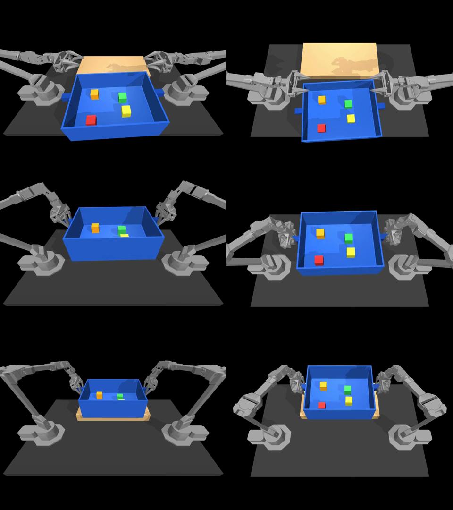

# Physical AI 応用1講座 最終課題 説明資料

## 1. 課題名
双腕ロボットによる中身入り物流コンテナの棚入れ — 模倣学習(ACT)× MuJoCo シミュレーション

## 2. 概要
物流倉庫では、部品の入ったコンテナ(通い箱)を棚へ運ぶ作業が日常的に発生する。本課題では、実在する物流コンテナ
(三甲 ラボボックス No.20、外寸 475×369×154 mm)を実寸で再現し、双腕ロボット(ViperX 300 ×2、ALOHA 構成)が
左右の取っ手をつまんで持ち上げ、中身(5cm 角の小箱 4 個・合計 2 kg)をこぼさずに奥の棚へ置くタスクを作った。
お手本データはスクリプトで自動生成し、模倣学習手法 ACT(Action Chunking with Transformers)で方策を学習した。

## 3. 目的
- 片腕では持てない大きさ・重さの物体を、両腕の協調動作で運ぶ方策を、カメラ画像と関節角度だけから学習できるかを確かめる
- 「運ぶ」だけでなく「中身をこぼさない」という品質条件まで含めて評価する

## 4. 方法
### 4.0 使用ツールと AI の使い方
- シミュレータ: MuJoCo 3.8.1(ロボットモデルは gym-aloha 0.1.4 の ViperX 300 双腕を使用)
- 学習・推論: LeRobot 0.4.4 の ACT(PyTorch 2.10、Apple GPU = MPS)
- AI の使い方: スクリプトで作ったお手本 50 本から ACT を学習し(模倣学習)、動画のロボットは**すべて学習済み ACT の推論で動いている**(カメラ画像と関節角度を入力し、関節の目標角度を出力)

### 4.1 環境(`tote_sim.py`)
- gym-aloha のロボットモデルを複製し、箱(底+壁4枚+取っ手2つ)・中身4個・棚(高さ 6 cm)・俯瞰カメラを追加
- 毎回、箱の位置(±3 cm)・向き(±5°)・中身の配置をランダムに変える
- 成功判定: 箱が棚の中央付近にあり、両手を離していて、中身 4 個すべてが箱の内寸の中に残り、傾き 5° 未満・ほぼ静止の状態が 0.5 秒続くこと
- 失敗分析のため、段階(つかむ/持ち上げる/棚の上へ/置いてこぼさない)・こぼれ数・最大傾き角を毎ステップ記録

### 4.2 データ収集(`scripted_policy.py`, `make_dataset.py`)
- 手先のウェイポイント(接近→降下→把持→持ち上げ→運搬→降下→解放→退避)を、なめらかな加減速で補間するお手本を作成
- 手先制御(mocap)で動かした関節軌道を、関節制御モードで再生し、成功したものだけを LeRobot 形式(v3.0)で保存
- 50 エピソード・26,000 フレーム(50Hz、1 エピソード 10.4 秒)。再生成功率 50/50

### 4.3 学習
- ACT(LeRobot 0.4.4)、入力 = 俯瞰カメラ画像(240×320)+ 両腕 14 関節、出力 = 100 ステップ先までの関節目標
- 100,000 ステップ、バッチ 8、Apple M5 Pro の GPU(MPS)で約 2.7 時間

## 5. 結果
### 5.1 通常条件(学習に使っていない初期配置 50 回、seed 10000〜10049)

| | 成功率 | 両手でつかむ | 持ち上げる | 棚の上へ | こぼれ率 | 平均最大傾き |
|---|---|---|---|---|---|---|
| 学習済み ACT(100k ステップ) | **100%(50/50)** | 100% | 100% | 100% | 0% | 1.0° |
| お手本スクリプト(関節再生) | 100%(50/50) | 100% | 100% | 100% | 0% | 0.9° |

- 学習途中(1 万ステップ)では 10 回中 7 回成功で、失敗 3 回はすべて「つかんだ後に持ち上げられない」だった。10 万ステップで全回成功に達した
- 1 回あたり約 9.4 秒(464〜481 ステップ)で成功判定に到達

### 5.2 外乱テスト(運搬中に箱を左右方向へ 0.2 秒押す、各 20 回)

| 押す力 | ACT 成功率 | お手本 成功率 | ACT こぼれ率 | お手本 こぼれ率 |
|---|---|---|---|---|
| 100 N | 100% | 100% | 0% | 0% |
| 200 N | 100% | 100% | 0% | 0% |
| 300 N | **40%** | 25% | **0%** | 20% |

- お手本は決まった関節軌道をなぞるだけなので、押されて箱がずれても立て直さない。ACT はカメラ画像と関節角度を見て次の動作を決めるため、強い外乱で成功率がやや高く、中身をこぼした回は 0 だった
- ただし各 20 回の比較で差は 3 回分であり、統計的に強い差とは言えない。300 N では ACT も 6 割失敗し、主な失敗は「棚の上まで運べない」(段階 2 止まり)

## 6. 工夫した点
- **実寸設計**: 製品の寸法から、両腕の付け根(約 94 cm 間隔)と取っ手の位置関係を計算し、双腕でつかめる配置を決めた
- **重さの事前試験**: 中身を上限の 3 kg にしても関節制御で運べることを、データ生成前に確認した(5/5 成功)
- **品質の数値化**: 成功/失敗だけでなく、どの段階で失敗したか・こぼれ数・傾き角を記録し、失敗分析に使えるようにした
- **データの質の担保**: 手先制御のお手本をそのまま使わず、学習時と同じ関節制御で再生して成功したものだけを残した
- **「偽の成功」の発見と修正**: 最初のデータでは、運搬中に手首の力が足りず取っ手が抜け、箱が棚に「落ちた」だけの動きまで成功と数えていた。
  評価動画を目で確認して気づき、①手首モーターを強化(+シミュレーションが発散しないよう関節に慣性を追加)、②成功判定を
  「棚の中央・傾き 5° 未満・静止が 0.5 秒続く」に厳格化したうえで、データ生成と学習をやり直した

## 7. 限界と今後
- シミュレーションのみ。実機の ViperX 300 の可搬重量では 2.5 kg(箱+中身)は持てない可能性が高い
- 指の握る力(10 倍)と手首のモーター(6〜20 倍)をシミュレーション上で強めている
- 箱の質量・壁の厚みは仮値、取っ手は単純化した形状
- 今後: 中身の重さ・個数のランダム化、カメラの追加(手首カメラ)、実機への転移

## 8. 提出物
- 動画: 学習済み ACT が、学習に使っていない初期配置でタスクを 7 回続けて実行する様子(等速・解説なし、69 秒)
- コード: GitHub リポジトリ(URL は提出フォームに記載)。再現手順は README.md と docs/workflow.md
